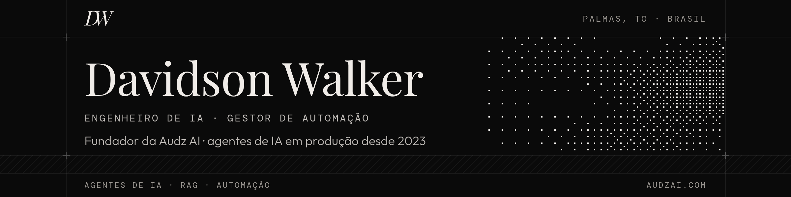

<picture>
  <source media="(prefers-color-scheme: dark)" srcset="assets/banner-escuro.png">
  <source media="(prefers-color-scheme: light)" srcset="assets/banner-claro.png">
  
</picture>

## >_ Olá, eu sou o Davidson

Engenheiro de IA e gestor de automação em Palmas, TO. Em 2024 fundei a [Audz AI](https://audzai.com), onde construo agentes de IA que atendem, vendem e dão suporte pelo WhatsApp. Já trabalhei com infoprodutores, escolas, construtoras, e-commerce e proteção veicular.

Cuido do projeto inteiro: arquitetura, desenvolvimento, infraestrutura e a operação depois que o agente entra no ar. Também treino o time do cliente para acompanhar o atendimento e ajustar a IA no dia a dia.

## >_ O que já foi pro ar

| Agente | Cliente | O que faz | Resultado |
| --- | --- | --- | --- |
| **Roberta** | Academia Rafael Toro de Finanças | Tira dúvidas dos alunos de CFP e CPA-20 em cerca de 20 grupos de WhatsApp, com RAG sobre o material do curso | 5 mil+ alunos, 2+ anos no ar |
| **Daniela** | Raiz da Solução | Recupera carrinho abandonado e checkout, com follow-up em áudio na voz do infoprodutor | +R$350 mil em 7 dias |
| **Sueli & Rita** | Comu RT | Multiagente: a Sueli cuida das vendas e a Rita do suporte técnico | −70% de dúvidas no time humano |
| **SDRs sob medida** | RealSmart · APS · NSA | Qualificam com SPIN selling, agendam por API e mandam link de venda com cupom | — |

Também montei agentes de venda consultiva de alto ticket para lançamentos do Érico Rocha e da Fernanda Landeiro, com picos de milhares de requisições por minuto na abertura de carrinho.

## >_ Como eu monto

```text
WhatsApp ─▶ Evolution API ─▶ n8n (modo worker) ─▶ LangChain / LangGraph ─▶ GPT · Claude · Gemini
                                                                            via OpenRouter
rastreio   Langfuse
filas      Redis · RabbitMQ
dados      PostgreSQL · Qdrant · pgvector
infra      Docker Swarm · Traefik · Portainer
```

## >_ Stack

**IA e agentes**<br>


**Automação e dados**<br>


**Infra e código**<br>


## >_ Estudando agora

Certificações em andamento: Google Cloud Generative AI Leader · AWS Certified AI Practitioner · Microsoft Azure AI Fundamentals (AI-901) · Oracle OCI AI Foundations · Anthropic Academy (Claude, Claude Code e MCP) · cursos oficiais do n8n.

## >_ Contato

<a href="https://www.linkedin.com/in/davidson-walker"></a>
<a href="https://audzai.com"></a>
<a href="https://www.instagram.com/audz.ai/"></a>
<a href="mailto:contato@audzai.com"></a>
